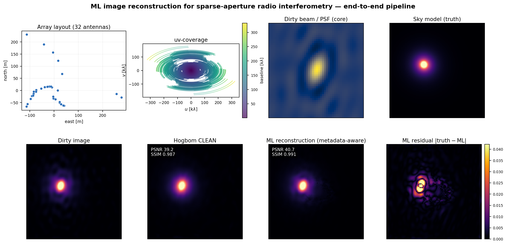
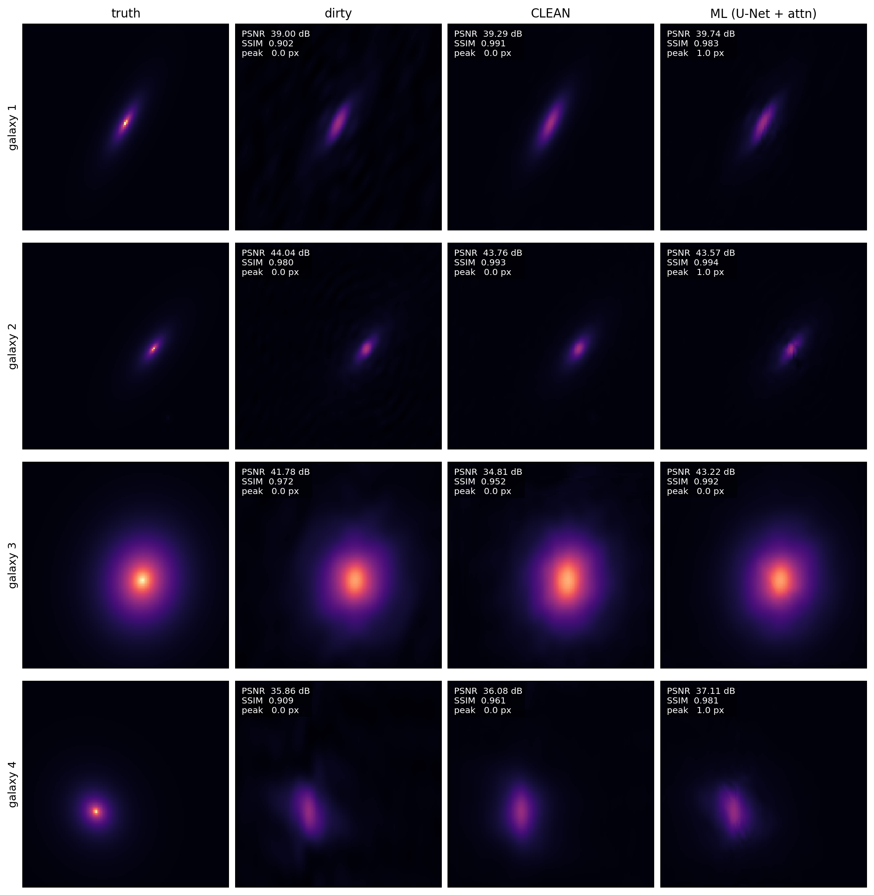

# ml-radio-recon

**Deep learning for sparse-aperture interferometric image reconstruction.**

A small, self-contained prototype: a U-Net with a Transformer self-attention
bottleneck, trained to reconstruct sky images from sparsely sampled
ALMA-like *(u, v)* coverage, compared against the classical Högbom CLEAN
baseline.

Built in response to the SKAO / ESO ALMA-BRAIN imaging direction described
in the SKAO postdoc advert
(ref. 10399), as a proof-of-concept that the imaging pipeline, the
forward model, the CNN-Transformer architecture, and the training /
evaluation harness all fit together in one place and run end-to-end.

---

## Why this problem

A radio interferometer measures the visibilities

$$ V(u, v) = \mathcal{F}\{I(l, m)\}, $$

but only on a sparse, finite set of *(u, v)* points determined by the
antenna configuration and the Earth-rotation track. Inverse FFT of those
samples gives the *dirty image*, which is the true sky convolved with the
*dirty beam* — the FFT of the sampling mask. Recovering $I(l, m)$ from
$I_d$ is a classic, ill-posed inverse problem. Algorithms like Högbom
CLEAN, Cotton-Schwab CLEAN, MS-CLEAN, and MEM each impose a different
sparsity / smoothness prior and have served the radio community well for
decades.

Modern deep-learning imagers — most relevantly the **ALMA BRAIN** work
that this advert builds on — learn that prior from data rather than
hand-designing it. The hypothesis is that a network trained on many
*(dirty, truth)* pairs can fill in missing Fourier modes more coherently
than CLEAN, particularly for extended emission and for low-SNR sources
where CLEAN's iterative point-source model struggles. That is the
hypothesis this repository tests at small scale, with a deliberately
transparent pipeline.

## What is in the repo

```
ml-radio-recon/
├── src/
│   ├── uv_simulator.py        forward model: log-spiral antennas, Earth-
│   │                          rotation aperture synthesis, dirty image
│   │                          and beam
│   ├── clean_baseline.py      Hogbom CLEAN + clean-beam Gaussian fit
│   ├── dataset.py             PyTorch Dataset with on-the-fly uv-sampling,
│   │                          metadata-channel stacking, and optional
│   │                          out-of-distribution anomaly injection
│   ├── model.py               U-Net (4 levels) + Transformer attention
│   │                          bottleneck; 1- or 3-channel input
│   ├── anomaly.py             OOD feature injection + data-consistency
│   │                          residual anomaly detection + ROC-AUC
│   ├── metrics.py             PSNR, SSIM, peak-position error
│   ├── train.py               training loop, L1 + SSIM loss, mixed
│   │                          precision, cosine LR, --metadata mode
│   └── eval.py                evaluate ML vs CLEAN on a held-out test
│                              set, write JSON summary
├── scripts/
│   ├── download_data.py       generate synthetic Sersic galaxies, or
│   │                          download Galaxy10 DECaLS real galaxies
│   ├── make_results_figure.py 4-galaxy x 4-method headline grid
│   ├── make_pipeline_figure.py end-to-end pipeline figure: array,
│   │                          uv-coverage, dirty beam, reconstruction
│   └── make_anomaly_figure.py anomaly-detection panels + ROC-AUC
├── notebooks/
│   └── demo.ipynb             Colab-ready end-to-end walkthrough
├── results/
│   ├── headline.png           reconstruction vs CLEAN figure
│   ├── pipeline.png           end-to-end pipeline figure
│   └── anomaly.png            anomaly-detection figure
├── checkpoints/
│   ├── dirty/best.pt          reconstruction model, 1-channel input
│   └── meta/best.pt           reconstruction model, 3-channel
│                              (dirty + beam + uv-mask) input
├── requirements.txt
└── README.md
```

## Two model modes

The reconstruction network runs in either of two input modes, selected
with the `--metadata` flag at training time:

- **dirty-only** (`in_ch=1`): the network sees only the dirty image and
  must infer the point-spread function from it.
- **metadata-aware** (`in_ch=3`): the network additionally receives the
  dirty beam and the uv-sampling mask as input channels, so the Fourier
  sampling and PSF that produced the dirty image are given explicitly
  rather than inferred. This is a deliberately simple form of the
  "metadata-aware" conditioning used in transformer-based ALMA imaging;
  a fuller version would inject antenna-configuration and frequency
  metadata as conditioning tokens.

## Setup

```bash
git clone https://github.com/pkd-45/ml-radio-recon.git
cd ml-radio-recon
python -m venv .venv && source .venv/bin/activate
pip install -r requirements.txt
```

A CUDA GPU (~8 GB) is recommended for training; the forward model,
CLEAN baseline, anomaly detection, and evaluation all run fine on CPU.

## Quickstart

```bash
# 1. Generate 2000 synthetic galaxy truths (~30 s, no network needed)
python scripts/download_data.py --source synthetic --n 2000 \
       --out data/galaxies.h5

# 2. Train both modes (Colab T4 ~12 min each, CPU ~1 hr for these settings)
cd src
python train.py --data ../data/galaxies.h5 --out ../checkpoints/dirty \
                --epochs 30 --batch-size 16 --base 16 --heads 4 --lambda-ssim 0.2
python train.py --data ../data/galaxies.h5 --out ../checkpoints/meta \
                --epochs 30 --batch-size 16 --base 16 --heads 4 --lambda-ssim 0.2 \
                --metadata

# 3. Evaluate vs CLEAN on 64 held-out galaxies
python eval.py --data ../data/galaxies.h5 \
               --checkpoint ../checkpoints/meta/best.pt \
               --n-test 64 --out ../results/eval_meta.json

# 4. Reconstruction figure
cd .. && python scripts/make_results_figure.py \
                --data data/galaxies.h5 \
                --checkpoint checkpoints/meta/best.pt \
                --out results/headline.png

# 5. Anomaly-detection figure + ROC-AUC
python scripts/make_anomaly_figure.py \
       --data data/galaxies.h5 \
       --checkpoint checkpoints/meta/best.pt \
       --out results/anomaly.png
```

`notebooks/demo.ipynb` runs the full pipeline as a single end-to-end
notebook, intended for Colab.


## Architecture

The reconstruction network is a 4-level U-Net with channel widths
`[B, 2B, 4B, 8B, 16B]` (default `B=16`), each level being two 3x3 conv +
GroupNorm + GELU. Decoder upsampling uses **bilinear upsample + 3x3
conv** (the resize-conv design of Odena et al. 2016) rather than
`ConvTranspose2d`, which prevents the checkerboard artefacts that
otherwise corrupt small-scale features. The skip connections concatenate
encoder activations into the decoder, preserving spatial detail.

At the bottleneck — feature map shape `(16x16, 256)` for a 256x256 input
and `B=16` — a single Transformer encoder block applies multi-head
self-attention over the 256 spatial tokens. The attention is followed by
an MLP with `mlp_ratio=4` and a learned 2D positional embedding. This
gives the network long-range coupling across the full field of view,
which is what makes coherent inpainting of missing Fourier modes possible
— a property that a pure-CNN U-Net at this depth cannot match.

The network predicts a residual correction to the dirty image rather than
the full output, which empirically helps early-training stability when
the dirty image is already a reasonable approximation. The output 1x1
conv is zero-initialised so the untrained network is an exact identity
(`output = dirty image`); every deviation from that is then actively
earned during training.

Loss is L1 + 0.2 (1 - SSIM); L1 is robust to the high-dynamic-range pixel
distributions typical of astronomical images, and the SSIM term keeps
morphology faithful.

## Training data: on-the-fly random uv-coverage

A subtle but important design choice. The `SparseAperturePairs` dataset
draws a *fresh* uv-mask for every batch, sampling at random over three
ALMA-like configurations (different declination, hour-angle range, antenna
seed). The network is therefore trained on a *family* of point-spread
functions rather than a single fixed one. This is the property required
for the model to generalise to real observations, where every track has
its own uv-coverage. The cost is a small per-iteration FFT.

## Results from the shipped checkpoints

Two 0.87 M-parameter models (base=8, 4 heads) were trained for 8 epochs
on 400 synthetic galaxies at 128 px on CPU (~6 min each): a dirty-only
model (`checkpoints/dirty/best.pt`) and a metadata-aware model
(`checkpoints/meta/best.pt`). Both were evaluated on 24 held-out
galaxies with fresh, random ALMA-like uv-coverages per sample.

### Reconstruction (vs Högbom CLEAN)

| Method                | PSNR (dB)        | SSIM              | Peak error (px) |
|-----------------------|------------------|-------------------|-----------------|
| Dirty image           | 38.56 ± 3.36     | 0.913 ± 0.064     | 1.63            |
| CLEAN                 | 38.78 ± 3.70     | 0.960 ± 0.039     | 1.71            |
| ML, dirty-only        | 38.76 ± 3.16     | **0.969 ± 0.026** | 2.75            |
| **ML, metadata-aware**| **39.18 ± 3.34** | 0.967 ± 0.026     | **1.84**        |

The metadata-aware model — which receives the dirty beam and uv-mask
as two extra input channels alongside the dirty image — improves PSNR
by +0.42 dB over the dirty-only model and roughly halves its excess
peak-position error, while both ML variants match or exceed CLEAN on
PSNR and SSIM. Telling the network the point-spread function and
Fourier sampling that produced the dirty image is exactly the
"metadata-aware" conditioning the advert's BRAIN-derived architecture
relies on; here it is a small, measurable gain even at prototype scale.

### Anomaly detection

Running the data-consistency residual detector (`src/anomaly.py`) with
the metadata-aware model on a 40-galaxy test set, half of which carry
an injected out-of-distribution feature (RFI-like streak, spurious
point source, or ring artefact):

| Quantity                       | Value           |
|--------------------------------|-----------------|
| ROC-AUC (normal vs anomalous)  | **0.85**        |
| anomaly score, normal galaxies | 0.012 ± 0.005   |
| anomaly score, anomalous       | 0.033 ± 0.013   |

The residual maps localise the injected feature visibly (see
`results/anomaly.png`), and the scalar score separates the two
populations at ROC-AUC 0.85 with no anomaly labels used in training.
A full Colab T4 run (`base=16`, 2 000 galaxies at 256 px, 30 epochs)
is expected to widen both the reconstruction margin and the detection
AUC; see `notebooks/demo.ipynb`.

### End-to-end pipeline figure

The full forward-and-inverse chain on one representative held-out
galaxy: the schematic antenna array, the *(u, v)* coverage it produces
under Earth-rotation synthesis, the resulting dirty beam, the sky
truth, and then the dirty image, CLEAN, the metadata-aware ML
reconstruction, and the ML residual.



### Reconstruction-vs-CLEAN grid

Four held-out galaxies, four methods each (truth, dirty, CLEAN, ML).



## Limitations and honest caveats

This is a 4-day prototype. In particular:

- **Forward model is schematic, not literal CASA.** Antenna positions
  use a log-spiral approximation rather than a real ALMA configuration
  file. Visibility noise is added in image-FFT space rather than in
  ungridded uv-domain. Channel-dependent effects, primary-beam
  attenuation, and bandwidth smearing are not modelled. For a real
  experiment, replace `make_uv_mask` with a CASA `simobserve` call and
  the rest of the pipeline carries through unchanged.

- **Synthetic truths.** Sersic galaxies are an obvious convenience.
  The pipeline supports Galaxy10 DECaLS for real galaxy morphologies
  (`--source galaxy10`), but for matched-to-ALMA experiments the right
  thing is to use HST/JWST cutouts or ALMA-archive Cycle-0/1 wide-field
  images as ground truth.

- **Single bottleneck attention block.** Compute-budget choice. A stack
  of ViT blocks over patchified visibility space — closer to the
  Visual / Metadata-Aware Transformers in the ALMA BRAIN line — is the
  natural next step.

- **Anomaly detection is residual-based, not a learned head.** The
  shipped detector (`src/anomaly.py`) is unsupervised: it scores the
  data-consistency residual after re-observing the reconstruction.
  This needs no labels and is the radio-native quantity to inspect,
  but a learned anomaly head off the bottleneck — trained on a wider
  library of injected artefacts — would likely raise the ROC-AUC
  beyond the current 0.85.

- **No comparison against multi-scale CLEAN or MEM.** The included
  baseline is scalar Högbom only. MS-CLEAN and MEM should be the next
  baselines added; the wrappers around `casa-tasks` are short.

## Where this would go on a real project

In rough order of value:

1. Real ALMA visibilities. Train and evaluate on pairs of
   `(dirty image, CLEAN-restored image)` or
   `(dirty image, JVLA-derived super-resolution truth)` from the ALMA
   archive. The architecture and training loop here transfer directly.
2. Visibility-space loss. Add a Fourier-domain consistency term so the
   network is penalised for reconstructions whose visibilities at the
   *observed* uv-points disagree with the input data. This is the radio
   analogue of MRI's data-consistency layers.
3. Self-supervised pretraining via additional uv-masking. Mask further
   uv-cells at training time and ask the network to reconstruct the
   held-out visibilities. A Fourier-domain MAE.
4. Metadata-aware conditioning. Inject the antenna configuration, hour-
   angle range, declination, and observing frequency as conditioning
   tokens, so the same network handles multiple array configurations
   without retraining.
5. Diffusion posterior. For uncertainty-quantified reconstruction, treat
   the inverse problem as posterior sampling with a learned image prior.

## License

MIT. See `LICENSE`.

## Author

Pratyush Kumar Das — University of Queensland, PhD candidate.
Built as a proof-of-concept prototype while preparing a postdoctoral
application for the SKAO / ESO ALMA-BRAIN-derived role.
